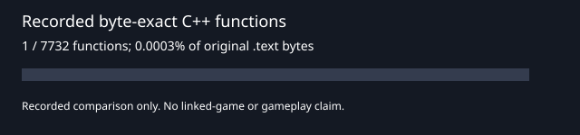

<p align="center"></p>

# Champions: Return to Arms — PS2 source reconstruction

Independently authored C++ that reproduces the original *Champions: Return to Arms*
PS2 executable, verified one complete function at a time. This repository targets
the US v2.00 release, `SLUS_209.73`.

**Current result: eight complete functions, 64 matching bytes.** The original target
contains 7,732 indexed functions and 3,038,272 bytes of `.text`. No complete linked
PS2 executable or playable game is available from this reconstruction.



## Project boundaries

Open Champions maintains separate repositories for each purpose:

| Repository | Owns |
|---|---|
| **This repository** | Return to Arms PS2 reconstruction sources, exact-byte ledger and verification |
| [Champions of Norrath](https://github.com/Open-Champions/champions-of-norrath) | The first game's separate PS2 reconstruction |
| [Open Champions Godot](https://github.com/Open-Champions/open-champions-godot) | Shared native Godot implementation for both games, targeting Mac and Windows without emulation |
| [Champions research](https://github.com/Open-Champions/champions-return-to-arms-re) | Reverse-engineering findings, subsystem maps, symbols, formats and online investigation |

The repositories share evidence and reviewed behavior contracts. A PS2 function
match does not establish native gameplay. Mac and Windows support here refers to
running the reconstruction tools; the native game belongs in the Godot repository.

## Start here

Python 3.10 or newer is enough to check the public metadata and run the synthetic
test suite. No original game files, emulator, compiler or SDK are needed for these checks:

```sh
python tools/rebuild.py check
python -m unittest discover -s tools -p 'test_*.py'
python tools/rebuild.py progress --json
python tools/rebuild.py candidates --limit 10
```

Public CI runs these checks on Linux x64, Apple Silicon and Intel Macs, Windows x64
and Windows ARM64, with an additional Python 3.14 job. It validates recorded evidence
and source fingerprints; it does not recompile against the private retail game.

For a fresh byte comparison, supply your own original executable and an existing
MIPS-capable Clang installation. The recorded leaf matched with LLVM 20.1.8; this
does not establish general R5900 toolchain compatibility.

```sh
python tools/rebuild.py verify --game /private/path/SLUS_209.73 --compiler /path/to/clang++ --report work/rebuild/verification.json
python tools/rebuild.py progress --report work/rebuild/verification.json --svg work/rebuild/progress.svg
```

Quote paths containing spaces. On Windows, use the corresponding `clang++.exe` path.
The verifier checks the baseline SHA-256, recompiles eligible C++ functions, rejects
relocations and extent mismatches, and compares every function byte. Objects and logs
stay in ignored `work/`. The default `check` and `progress` commands validate the
[sanitized recorded receipt](targets/SLUS-20973/verification.json).

Read [the rebuild workflow](docs/REBUILD.md), [contribution rules](CONTRIBUTING.md),
and [agent coordination](AGENTS.md) before claiming a function. [ORIGIN.md](ORIGIN.md)
records the preserved history and the controlled function-index snapshot.

## Contents

- `reconstructed/`: authored reconstruction C++.
- `targets/SLUS-20973/`: target identity, function ledger and sanitized match receipt.
- `ghidra_funcs.tsv`: frozen function-boundary metadata imported from research.
- `tools/rebuild*.py`: verification, checkout-local claims and optional commit gate.
- `docs/REBUILD.md`: methodology, proof boundaries and outstanding compiler work.

Original executables, disc images, BIOS/SDK files, game assets, raw disassembly and
raw decompiler output are excluded. Keep your reference files private. See
[LICENSE](LICENSE) for authored code and documentation. *Champions: Return to Arms*
and its marks belong to their rights holders; Open Champions is an independent
community project with no affiliation or endorsement.
